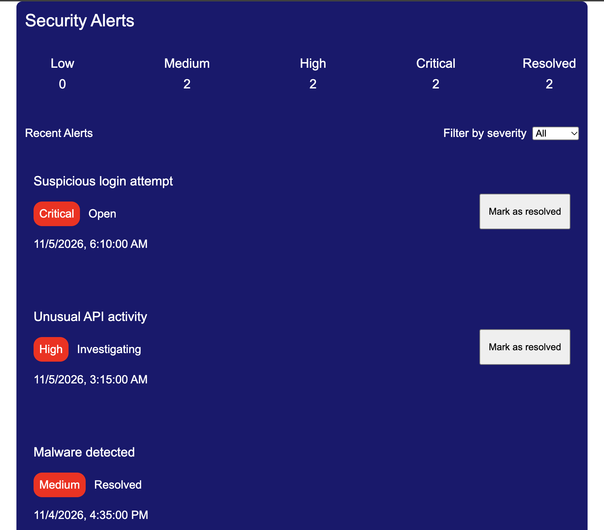

# Security Alert Dashboard

A React and TypeScript application for viewing, filtering, and managing security alerts. Built to demonstrate component-based architecture, type-safe state management, and interactive dashboard development.

## Screenshot



## Features

- **Alert Dashboard:** Displays security alerts with relevant details, including severity, status, and timestamps.
- **Severity Filtering:** Filter alerts by severity level (Low, Medium, High, Critical).
- **Alert Summary:** View alert counts grouped by severity.
- **Alert Management:** Mark alerts as resolved and see the updated dashboard state.
- **Component-Based Design:** Separates dashboard, filtering, summary, and alert presentation into reusable React components.

## Tech Stack

- **React** — Component-based UI development
- **TypeScript** — Type-safe components, props, and data models
- **Vite** — Development server and build tooling
- **CSS** — Custom component styling
- **ESLint** — Code quality and consistency

## Architecture

The application uses a component-based architecture with clear separation of responsibilities.

Key components:

- `AlertDashboard` — Coordinates dashboard functionality and state.
- `AlertCardList` — Renders the collection of alerts.
- `AlertCard` — Displays individual alert information.
- `AlertSummary` — Displays alert counts by severity.
- `Filter` — Provides severity-based filtering.

Additional organization:

- `interfaces/` — TypeScript interfaces and data types.
- `mocks/` — Sample security alert data.
- `utils/` — Utility functions for alert-related calculations.

### Technical Highlights

- Strongly typed React components and event handlers.
- Derived data for filtering and severity summaries.
- React state management for interactive alert updates.
- Separation of UI components, data models, and utility functions.
- Mock data to demonstrate dashboard functionality without requiring a backend.

## Getting Started

### Prerequisites

- Node.js
- npm

### Installation

Clone the repository:

```bash
git clone https://github.com/sujoynair79/security-alert-dashboard.git
cd security-alert-dashboard
```

Install dependencies:

```bash
npm install
```

Start the development server:

```bash
npm run dev
```

Open the local URL displayed in your terminal.

## Future Improvements

- Integrate a backend API for real-time security alerts.
- Add sorting and pagination.
- Introduce unit and component tests.
- Improve accessibility and responsive behavior.
- Add support for larger datasets through server-side filtering.

## About

This project is part of a collection of hands-on React and TypeScript applications exploring frontend architecture, state management, and practical UI engineering patterns.
